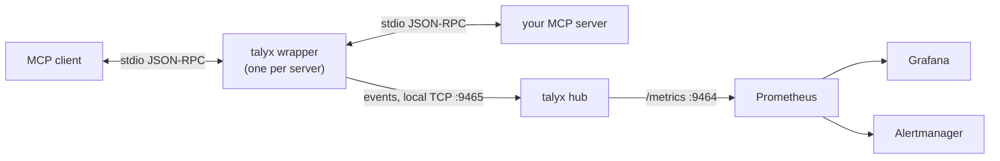

<p align="center">
  <picture>
    <source media="(prefers-color-scheme: dark)" srcset="https://raw.githubusercontent.com/alan66603/talyx-mcp/main/docs/images/logo-dark.svg">
    <source media="(prefers-color-scheme: light)" srcset="https://raw.githubusercontent.com/alan66603/talyx-mcp/main/docs/images/logo-light.svg">
    
  </picture>
</p>

# talyx-mcp

English | [繁體中文](https://github.com/alan66603/talyx-mcp/blob/main/README.zh-TW.md)

[](https://pypi.org/project/talyx-mcp/)
[](https://github.com/alan66603/talyx-mcp)
[](https://opensource.org/licenses/Apache-2.0)
[](https://www.python.org/downloads/)
[](https://modelcontextprotocol.io)
[](https://github.com/astral-sh/ruff)

**Prometheus exporter and alerting for MCP servers.** When your MCP server breaks, your users just see a broken agent—you see exactly which server failed, how slow it got, and when. Wrap any stdio server, **zero code changes**.

Talyx is a **zero-code proxy**: it sits between your MCP client and server,
forwards the stdio JSON-RPC untouched, and exports Prometheus metrics about the
traffic. It ships with a Grafana dashboard and Alertmanager rules. It is
**stateless** — no database, Prometheus just scrapes `/metrics`.



## Table of Contents

- [talyx-mcp](#talyx-mcp)
  - [Table of Contents](#table-of-contents)
  - [Quick start](#quick-start)
    - [Servers talyx cannot wrap](#servers-talyx-cannot-wrap)
  - [Demo](#demo)
  - [Install and manual use](#install-and-manual-use)
    - [Behind a gateway](#behind-a-gateway)
  - [The hub](#the-hub)
  - [Metrics](#metrics)
  - [Alerts](#alerts)
  - [How it works](#how-it-works)
  - [Roadmap](#roadmap)
  - [License](#license)
  - [Author](#author)

## Quick start

Three commands, for Claude Code users:

```bash
uv tool install talyx-mcp   # install globally (see note below)
talyx wrap                  # wrap your existing Claude Code MCP servers
talyx dashboard up          # Prometheus + Alertmanager + Grafana, one command
```

Open **http://localhost:3000** (Grafana) or **http://localhost:9090**
(Prometheus). `talyx wrap` takes effect in **new** Claude Code sessions.

- `talyx wrap --dry-run` shows what would change without touching anything.
  `talyx unwrap` restores the originals.
- `wrap` rewrites your own Claude Code MCP servers (user scope plus the current
  directory's local scope) through `claude mcp remove` / `add-json`. The
  originals are backed up to `~/.talyx/wrap-backup.json` (mode 0600, directory
  0700). Note that during `wrap` / `unwrap`, `claude mcp add-json` receives the
  server spec, including its `env`, as a command-line argument, and those same
  values already live in `~/.claude.json`; the backup file is not the only place
  they appear.
- Install talyx globally (`uv tool install talyx-mcp`). `wrap` warns if `talyx`
  resolves inside a virtualenv, because the wrapped command must keep working
  outside it.
- `talyx dashboard down` stops the stack; data is kept in named Docker volumes
  across down/up. The stack needs **Docker** and runs as the compose project
  `talyx-dashboard`; `up` also makes sure the hub is running.
- The dashboard stack uses the same ports as the demo stack below
  (9090 / 3000 / 9093, and 9464 for metrics). Stop one before starting the other.
- talyx runs on **macOS and Linux**. Windows is not supported yet.

### Servers talyx cannot wrap

These are not in `~/.claude.json`, so `talyx wrap` never sees them and does not
list them:

- **Plugin-provided servers** (managed by the plugin, not by your config).
- **claude.ai connectors.**

These are in your config, and `talyx wrap` skips them and says why:

- **Project scope** (`.mcp.json`): wrapping would commit your personal absolute
  paths into a shared file.
- **URL (http) servers with headers**: talyx will not move credentials into
  command-line arguments.
- **sse servers.**

http servers *without* headers are wrapped through
`npx -y mcp-remote@0.16.5 <url>`. That is a third-party package; for servers
that use OAuth, run it once in a terminal first to log in.

## Demo

Runs talyx + a sample MCP server + Prometheus + Alertmanager + Grafana, with
live traffic, in one command:

```bash
git clone https://github.com/alan66603/talyx-mcp.git
cd talyx-mcp
docker compose -f deploy/compose/demo.yaml up --build
```

Then open **http://localhost:3000** → dashboard **MCP Overview** (anonymous, no
login). You'll see request rate, error rate, p95 latency, and the flagship
**Multi Round-Trip** panels — elicitation loops, round-trips per request, and
**abandoned cycles** (agents silently stuck waiting on a confirmation) — updating
live. Prometheus is on `:9090`, Alertmanager on `:9093`.

## Install and manual use

Install from PyPI:

```bash
pip install talyx-mcp
```

Or from source:

```bash
git clone https://github.com/alan66603/talyx-mcp.git
cd talyx-mcp
pip install .
```

Either way, the CLI command is `talyx`. Point your MCP client at it instead of
the server, and pass the real command after `--`:

```jsonc
// before
{ "command": "npx", "args": ["-y", "@modelcontextprotocol/server-everything"] }

// after — same server, now observed
{ "command": "talyx", "args": ["--", "npx", "-y", "@modelcontextprotocol/server-everything"] }
```

This `talyx -- <cmd>` form is the underlying mechanism; `talyx wrap` just
rewrites your config into it for you.

Metrics are then at `http://localhost:9464/metrics`, served by the hub (next
section). Configure the port with `TALYX_METRICS_PORT` / `TALYX_METRICS_HOST`. To
also push metrics over OTLP, set `TALYX_OTLP_ENDPOINT` and install the extra:
`pip install 'talyx-mcp[otlp]'` (Prometheus `/metrics` stays on regardless).

> The flagship cycle metrics need a server that speaks MCP `2026-07-28`
> (`InputRequiredResult`). Wrapping an older server still gives you the core
> reliability metrics; to see the cycle panels, try the bundled mock server:
> `talyx -- python -m talyx.mock.server`. It also works inside Claude Code:
> `claude mcp add talyx-mock -- talyx -- python -m talyx.mock.server`, then ask
> Claude to call its `cycle` tool (`kind`: `input`, `poll` or `reject`).

### Behind a gateway

talyx is not a gateway and doesn't route, authenticate or filter tools. It
works alongside one: wherever a gateway launches a stdio server from a
command, put `talyx --` in front of that command. For example, with IBM's
[ContextForge](https://github.com/IBM/mcp-context-forge), which exposes a stdio
server over HTTP through `mcpgateway.translate`:

```bash
# before
python3 -m mcpgateway.translate --stdio "uvx mcp-server-git" --expose-sse --port 9000

# after: the gateway routes, talyx observes the server behind it
python3 -m mcpgateway.translate --stdio "talyx -- uvx mcp-server-git" --expose-sse --port 9000
```

Each wrapped server reports to the hub on the same machine, so `/metrics`
covers every server behind the gateway. If the gateway runs servers in their
own containers, set `TALYX_HUB=off` and scrape each container's port instead.

## The hub

Every `talyx -- <cmd>` wrapper ships its events over local TCP
(`127.0.0.1:9465`, `TALYX_HUB_PORT`) to **one** long-lived hub that talyx spawns
automatically (`talyx hub`). The hub serves the single `/metrics` on `:9464` and
handles `TALYX_OTLP_ENDPOINT`, so many MCP servers (and many Claude Code
sessions) show up in one place instead of fighting over a port. Events are
queued and sent as soon as the hub is up; nothing falls back to a local port
unless you set `TALYX_HUB=off`, which restores the old per-process `/metrics`.
The hub log is `~/.talyx/hub.log`.

Running the hub:

- **Stop it** with `pkill -f "talyx hub"`. It keeps running after
  `talyx unwrap` and `talyx dashboard down`, and after `uv tool upgrade`; restart
  it (stop it, then open a wrapped session or run `talyx dashboard up`) to pick
  up new code.
- **Its config** (`TALYX_OTLP_ENDPOINT`, `TALYX_METRICS_HOST` /
  `TALYX_METRICS_PORT`) comes from the environment of whichever wrapper starts
  it. The hub gets only `TALYX_*` and a few basics (`PATH`, `HOME`, `USER`,
  locale, `TMPDIR`) from that environment, not your servers' secrets, and runs
  from your home directory.
- **`/metrics` binds `0.0.0.0` by default**, so it is reachable from your
  network. Set `TALYX_METRICS_HOST=127.0.0.1` to keep it local.
- **After a reboot** the dashboard containers come back on their own, but the
  hub starts only with the next wrapped session or `talyx dashboard up`.

The hub receives only event fields (method name, tool name, durations,
`wait_type`, error codes), never parameters, results, or `requestState`.

`talyx_server_up` distinguishes a clean exit from a crash: if the client closes
first and the server then exits normally, the series is removed and nothing
alerts; if the client is still connected and the server exits by itself, it goes
to `0`. Stopping the wrapper with SIGTERM / SIGINT (as some MCP clients do)
counts as clean. A crashed server's `0` series is removed after 15 minutes if it
does not come back, so a server you stopped using does not stay down forever.
Edge case: if the client closes and the server later crashes on its own, it is
still reported as clean.

## Metrics

Aligned to the MCP `2026-07-28` (stateless) spec. Full reference:
[docs/metrics.md](https://github.com/alan66603/talyx-mcp/blob/main/docs/metrics.md).

**Core reliability**

| Metric | Type | Labels |
|---|---|---|
| `talyx_requests_total` | counter | `method`, `server`, `status` |
| `talyx_request_duration_seconds` | histogram | `method`, `server` |
| `talyx_errors_total` | counter | `method`, `server`, `error_code` |

**Multi Round-Trip cycles — the flagship.** In MCP's latest version, `2026-07-28` server can answer a
`tools/call` with an `InputRequiredResult` and the client re-sends with the
server's `requestState`; that elicitation loop is one *logical* request that
generic APM reads as two unrelated ones.

| Metric | Type | Labels |
|---|---|---|
| `talyx_input_required_total` | counter | `method`, `server`, `wait_type` |
| `talyx_round_trips_per_request` | histogram | `wait_type` |
| `talyx_round_trip_cycle_duration_seconds` | histogram | `wait_type` |
| `talyx_input_wait_duration_seconds` | histogram | `server`, `wait_type` |
| `talyx_abandoned_cycles_total` | counter | `server`, `wait_type` |
| `talyx_request_state_rejected_total` | counter | `server` |

Plus basic liveness (`talyx_server_up`, `talyx_inflight_requests_lost_total`) and
`talyx_proxy_overhead_seconds`.

**`talyx_abandoned_cycles_total`** counts cycles where the server sent an
`InputRequired` but got no follow-up. No error, no timeout, which can be overlooked. A single count means little (users pause or walk away), but a spike
above baseline usually signals a broken or confusing prompt, especially around
high-risk `InputRequiredResult` gates.

**Security:** Talyx does not record tool argument contents or message bodies; it
only reads method and tool names, outcomes, and timings. The hub receives only
those event fields, never parameters, results, or `requestState`. The one correlation key it needs (the
sealed `requestState` token) is **hashed in memory and never stored**. See [docs/metrics.md](https://github.com/alan66603/talyx-mcp/blob/main/docs/metrics.md).

**Overhead:** talyx's own per-chunk processing is sub-millisecond
(`talyx_proxy_overhead_seconds`), so it doesn't meaningfully slow the server down.

## Alerts

`talyx dashboard up` (and the demo) load these rules into Prometheus,
which hands firing alerts to Alertmanager. They live in
[alerts/mcp-rules.yaml](https://github.com/alan66603/talyx-mcp/blob/main/alerts/mcp-rules.yaml),
so you can also point your own Prometheus at them.

| Alert | Fires when | For |
|---|---|---|
| `MCPServerDown` | a wrapped server crashed (`talyx_server_up == 0`) | 1m |
| `MCPExporterDown` | Prometheus can't scrape talyx | 1m |
| `MCPHighErrorRate` | more than 10% of requests fail over 5m | 2m |
| `MCPHighLatencyP95` | a method's p95 latency is above 2s over 5m | 5m |
| `MCPAbandonedCyclesSpike` | cycles are abandoned faster than 0.05/s | 5m |
| `MCPRunawayCycles` | any cycle takes more than 10 round-trips | 5m |
| `MCPRequestStateRejectedSpike` | `requestState` rejections exceed 0.05/s | 5m |
| `MCPCycleServerSideSlow` | average server-side time per cycle (cycle time minus time waiting on the user) is above 2s | 5m |

- **Low traffic doesn't page you.** The error-rate and latency alerts only
  evaluate once there are at least 20 requests in the 5-minute window (per
  method, for latency). Otherwise a few late failures can read as 80%.
- **Slow users don't page you either.** `MCPCycleServerSideSlow` subtracts
  `input_wait` from the cycle time, so a person taking minutes to confirm
  doesn't count as server slowness.
- The 2s latency threshold is a single global value; browser-automation servers
  whose page loads routinely take longer may trip it.

## How it works

The proxy forwards bytes in both directions untouched and observes the
JSON-RPC as a side-channel — if observation ever fails, forwarding is
unaffected. It's stateless by design, which is the core difference from
trace-based tools. See [docs/architecture.md](https://github.com/alan66603/talyx-mcp/blob/main/docs/architecture.md)
for the positioning table and the "why a proxy, not an SDK" rationale.

## Roadmap

Optional OTLP **metrics** export already ships (`TALYX_OTLP_ENDPOINT`), and
the proxy forwards W3C `traceparent` untouched. Still ahead: OTLP **trace/span**
export (to your own Tempo/Jaeger), HTTP transport + OAuth, a Helm chart, and
optional body capture. Token usage isn't visible in MCP protocol traffic, so
Talyx does not claim token metrics.

## License

Apache-2.0. See [LICENSE](https://github.com/alan66603/talyx-mcp/blob/main/LICENSE).

## Author

[](https://www.linkedin.com/in/tsung-yao-chen-75481718b)
