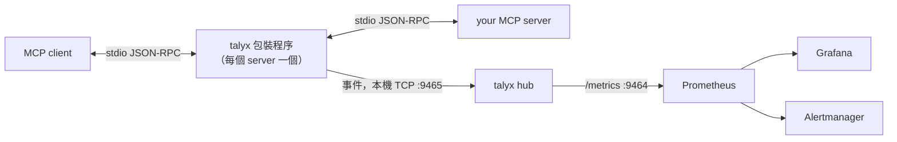

<p align="center">
  <picture>
    <source media="(prefers-color-scheme: dark)" srcset="https://raw.githubusercontent.com/alan66603/talyx-mcp/main/docs/images/logo-dark.svg">
    <source media="(prefers-color-scheme: light)" srcset="https://raw.githubusercontent.com/alan66603/talyx-mcp/main/docs/images/logo-light.svg">
    
  </picture>
</p>

# talyx-mcp

[English](https://github.com/alan66603/talyx-mcp/blob/main/README.md) | 繁體中文

[](https://pypi.org/project/talyx-mcp/)
[](https://github.com/alan66603/talyx-mcp)
[](https://opensource.org/licenses/Apache-2.0)
[](https://www.python.org/downloads/)
[](https://modelcontextprotocol.io)
[](https://github.com/astral-sh/ruff)

**MCP server 的 Prometheus 匯出器與告警工具。** 包在任何 stdio MCP server
外面，**不必改一行程式碼**，就能在 server 壞掉或變慢的當下馬上知道，且讓你可以確切知道壞掉的地方。

Talyx 是一個 zero-code proxy：它坐在你的 MCP client 與 server 之間，原封不動地轉發
stdio JSON-RPC，並把流量的 Prometheus 指標匯出。內附一組 Grafana dashboard 與
Alertmanager 規則。它是 **stateless** 的——沒有資料庫，Prometheus 直接抓 `/metrics`。



## 目錄

- [talyx-mcp](#talyx-mcp)
  - [目錄](#目錄)
  - [Quick Start](#quick-start)
    - [talyx 包不了的 server](#talyx-包不了的-server)
  - [Demo](#demo)
  - [安裝與手動使用](#安裝與手動使用)
    - [搭配 gateway 使用](#搭配-gateway-使用)
  - [Hub](#hub)
  - [指標](#指標)
  - [告警](#告警)
  - [運作方式](#運作方式)
  - [Roadmap](#roadmap)
  - [License](#license)
  - [作者](#作者)

## Quick Start

給 Claude Code 使用者，三行指令：

```bash
uv tool install talyx-mcp   # 全域安裝（見下方說明）
talyx wrap                  # 包住你現有的 Claude Code MCP server
talyx dashboard up          # Prometheus + Alertmanager + Grafana，一行啟動
```

打開 **http://localhost:3000**（Grafana）或 **http://localhost:9090**（Prometheus）。
`talyx wrap` 在**新開的** Claude Code session 才會生效。

- `talyx wrap --dry-run` 只顯示會改什麼，不動任何設定。`talyx unwrap` 還原原本的設定。
- `wrap` 會透過 `claude mcp remove` / `add-json` 改寫你自己的 Claude Code MCP server
  （user scope 與目前目錄的 local scope），原始設定備份在 `~/.talyx/wrap-backup.json`
  （權限 0600，目錄 0700）。請注意：`wrap` / `unwrap` 執行期間，`claude mcp add-json`
  會把 server 設定（包含 `env`）當成命令列參數收到，而同樣的值本來就存在
  `~/.claude.json` 裡；備份檔並不是這些值唯一出現的地方。
- 請全域安裝 talyx（`uv tool install talyx-mcp`）。若 `talyx` 解析到虛擬環境內，`wrap`
  會警告，因為被包住的指令必須在虛擬環境外也能執行。
- `talyx dashboard down` 會停掉整組服務；資料保存在具名 Docker volume，down/up 之間不會
  消失。這組服務需要 **Docker**，以 compose project `talyx-dashboard` 執行；`up` 也會順便
  確保 hub 在跑。
- dashboard 與下方 demo 堆疊使用相同埠號（9090 / 3000 / 9093，指標用 9464）。
  一次只能開其中一組，另一組要先停掉。
- talyx 支援 **macOS 與 Linux**，目前還不支援 Windows。

### talyx 包不了的 server

下列項目不在 `~/.claude.json` 裡，`talyx wrap` 看不到它們，也不會列出：

- **Plugin 帶的 server**（由 plugin 管理，不在你的設定裡）。
- **claude.ai connector。**

下列項目在你的設定裡，`talyx wrap` 會跳過並說明原因：

- **Project scope**（`.mcp.json`）：包下去會把你個人的絕對路徑提交進共用檔案。
- **帶 headers 的 URL（http）server**：talyx 不會把憑證搬進命令列參數。
- **sse server。**

*不帶* headers 的 http server 會改用 `npx -y mcp-remote@0.16.5 <url>` 包起來。那是第三方
套件；若 server 走 OAuth，請先在終端機單獨執行一次來登入。

## Demo

一行指令跑起 talyx + 一個範例 MCP server + Prometheus + Alertmanager + Grafana，
外加即時流量：

```bash
git clone https://github.com/alan66603/talyx-mcp.git
cd talyx-mcp
docker compose -f deploy/compose/demo.yaml up --build
```

接著打開 **http://localhost:3000** → dashboard **MCP Overview**（匿名，免登入）。
你會看到 request rate、error rate、p95 latency，以及招牌的 **Multi Round-Trip** 面板
——elicitation 循環、每個請求的往返次數，還有 **abandoned cycles**（agent 靜默卡在
等一個永遠不來的確認）——全部即時更新。Prometheus 在 `:9090`，Alertmanager 在 `:9093`。

## 安裝與手動使用

```bash
pip install talyx-mcp
```

或

```bash
git clone https://github.com/alan66603/talyx-mcp.git
cd talyx-mcp
pip install .
```

兩種方式裝出來的 CLI 指令都是 `talyx`。把你的 MCP client 指向它（而不是 server），
真正的指令放在 `--` 後面：

```jsonc
// 改之前
{ "command": "npx", "args": ["-y", "@modelcontextprotocol/server-everything"] }

// 改之後——同一個 server，現在被觀測了
{ "command": "talyx", "args": ["--", "npx", "-y", "@modelcontextprotocol/server-everything"] }
```

這個 `talyx -- <cmd>` 寫法是底層機制；`talyx wrap` 只是幫你把設定改寫成這種形式。

指標就會在 `http://localhost:9464/metrics`，由 hub（見下一節）提供。用
`TALYX_METRICS_PORT` / `TALYX_METRICS_HOST` 設定埠號。若還想把指標推到 OTLP，設 `TALYX_OTLP_ENDPOINT`
並裝上額外相依：`pip install 'talyx-mcp[otlp]'`（Prometheus `/metrics` 一律照常開著）。

> 招牌的循環指標需要一個講 MCP `2026-07-28`（會回 `InputRequiredResult`）的 server。
> 包在舊 server 上仍能拿到核心可靠性指標；想看循環面板，可以用內附的 mock server：
> `talyx -- python -m talyx.mock.server`。也可以直接加進 Claude Code：
> `claude mcp add talyx-mock -- talyx -- python -m talyx.mock.server`，再請 Claude 呼叫它的
> `cycle` 工具（`kind` 可選 `input`、`poll` 或 `reject`）。

### 搭配 gateway 使用

talyx 不是 gateway，不做路由、認證或 tool 過濾，但可以和 gateway 一起用：只要 gateway 是用一行指令
啟動 stdio server，就在那行指令前面加上 `talyx --`。以 IBM 的
[ContextForge](https://github.com/IBM/mcp-context-forge) 為例，它用 `mcpgateway.translate` 把 stdio
server 轉成 HTTP：

```bash
# 改之前
python3 -m mcpgateway.translate --stdio "uvx mcp-server-git" --expose-sse --port 9000

# 改之後：gateway 負責路由，talyx 觀測背後的 server
python3 -m mcpgateway.translate --stdio "talyx -- uvx mcp-server-git" --expose-sse --port 9000
```

每個被包住的 server 都會回報給同一台機器上的 hub，所以一個 `/metrics` 就涵蓋 gateway 背後的所有
server。如果 gateway 把每個 server 放在各自的容器裡跑，請設 `TALYX_HUB=off`，改成分別抓各容器的埠。

## Hub

每個 `talyx -- <cmd>` 包裝程序都會把事件經由本機 TCP（`127.0.0.1:9465`，
`TALYX_HUB_PORT`）送到**一個**常駐 hub（talyx 自動啟動，即 `talyx hub`）。hub 負責
唯一的 `/metrics`（`:9464`），也負責處理 `TALYX_OTLP_ENDPOINT`，所以多個 MCP server
（與多個 Claude Code session）會匯集在同一處，而不是搶同一個埠。事件會先排隊，hub 一起來
就送出；除非設 `TALYX_HUB=off`（恢復舊的每程序各開 `/metrics`），否則不會退回本機埠。
hub 的 log 在 `~/.talyx/hub.log`。

hub 的運作：

- **停止 hub**：`pkill -f "talyx hub"`。`talyx unwrap`、`talyx dashboard down` 與
  `uv tool upgrade` 之後 hub 都會繼續跑；要套用新版程式碼，請重啟它（先停掉，再開一個
  被包住的 session 或執行 `talyx dashboard up`）。
- **hub 的設定**（`TALYX_OTLP_ENDPOINT`、`TALYX_METRICS_HOST` / `TALYX_METRICS_PORT`）
  取自啟動它的那個包裝程序的環境變數。hub 只會從該環境繼承 `TALYX_*` 與少數基本變數
  （`PATH`、`HOME`、`USER`、語系、`TMPDIR`），不會拿到你 server 的機密，並以你的家目錄
  為工作目錄執行。
- **`/metrics` 預設綁定 `0.0.0.0`**，同網路的其他機器連得到。設
  `TALYX_METRICS_HOST=127.0.0.1` 可只限本機。
- **重開機後** dashboard 的容器會自己回來，但 hub 要等下一個被包住的 session 或
  `talyx dashboard up` 才會啟動。

hub 只收事件欄位（方法名、tool 名、耗時、`wait_type`、錯誤碼），不收參數、結果或
`requestState`。

`talyx_server_up` 會區分正常結束與崩潰：client 先關閉、server 隨後正常結束，該序列會被
移除、不告警；client 仍連線、server 自己結束，則設為 `0`。以 SIGTERM / SIGINT 停止
包裝程序（部分 MCP client 會這樣做）視為正常結束。崩潰後的 `0` 序列若 15 分鐘內 server
沒有再起來就會被移除，不再使用的 server 不會永遠顯示為 down。邊界情況：若 client 關閉後
server 才自行崩潰，仍會被視為正常結束。

## 指標

對齊 MCP `2026-07-28`（stateless）規格。完整參考：[docs/metrics.zh-TW.md](https://github.com/alan66603/talyx-mcp/blob/main/docs/metrics.zh-TW.md)。

**核心可靠性**

| 指標 | 型別 | Labels |
|---|---|---|
| `talyx_requests_total` | counter | `method`、`server`、`status` |
| `talyx_request_duration_seconds` | histogram | `method`、`server` |
| `talyx_errors_total` | counter | `method`、`server`、`error_code` |

**Multi Round-Trip 循環——招牌指標。** MCP `2026-07-28` 版本更新後，server 可以用
`InputRequiredResult` 回應 `tools/call`，client 再帶著 server 的 `requestState` 重送；
這個 elicitation 循環是**一個**邏輯請求，但通用 APM 會把它讀成兩個不相干的請求。

| 指標 | 型別 | Labels |
|---|---|---|
| `talyx_input_required_total` | counter | `method`、`server`、`wait_type` |
| `talyx_round_trips_per_request` | histogram | `wait_type` |
| `talyx_round_trip_cycle_duration_seconds` | histogram | `wait_type` |
| `talyx_input_wait_duration_seconds` | histogram | `server`、`wait_type` |
| `talyx_abandoned_cycles_total` | counter | `server`、`wait_type` |
| `talyx_request_state_rejected_total` | counter | `server` |

<p align="center">
  
  
</p>

每個指標的示意圖見 [docs/metrics.zh-TW.md](https://github.com/alan66603/talyx-mcp/blob/main/docs/metrics.zh-TW.md)。

另有基礎 liveness（`talyx_server_up`、`talyx_inflight_requests_lost_total`）與
`talyx_proxy_overhead_seconds`。

**`talyx_abandoned_cycles_total`** 記錄 server 發出 `InputRequired` 卻沒等到
回覆的循環。這不會產生任何 error 回覆，因此容易被忽略。單次計數並無代表性(使用者可能
只是離開)，但比率異常升高可能表示提示壞了或令人困惑，在高風險的
`InputRequiredResult` 把關處值得參考。

**隱私與安全：** Talyx **不記錄 tool 參數內容**、不記錄訊息內容，只讀取 method/tool
名稱、結果與時間。hub 也只收這些事件欄位，不收參數、結果或 `requestState`。它唯一需要的關聯鍵（密封的 `requestState` token）**在記憶體內雜湊、
絕不落地**。詳見 [docs/metrics.zh-TW.md](https://github.com/alan66603/talyx-mcp/blob/main/docs/metrics.zh-TW.md)。

**額外開銷：** talyx 自身每個 chunk 的處理是次毫秒等級（`talyx_proxy_overhead_seconds`），
所以不會實質拖慢 server。

## 告警

`talyx dashboard up`（以及 demo）會把下列規則載入 Prometheus，觸發後交給 Alertmanager。規則檔在
[alerts/mcp-rules.yaml](https://github.com/alan66603/talyx-mcp/blob/main/alerts/mcp-rules.yaml)，
也可以直接接到你自己的 Prometheus。

| 告警 | 觸發條件 | 持續 |
|---|---|---|
| `MCPServerDown` | 被包的 server 崩潰（`talyx_server_up == 0`） | 1m |
| `MCPExporterDown` | Prometheus 抓不到 talyx | 1m |
| `MCPHighErrorRate` | 5 分鐘內超過 10% 的請求失敗 | 2m |
| `MCPHighLatencyP95` | 某個 method 5 分鐘內的 p95 延遲超過 2 秒 | 5m |
| `MCPAbandonedCyclesSpike` | 被放棄的循環每秒超過 0.05 次 | 5m |
| `MCPRunawayCycles` | 有循環超過 10 次往返 | 5m |
| `MCPRequestStateRejectedSpike` | `requestState` 被拒每秒超過 0.05 次 | 5m |
| `MCPCycleServerSideSlow` | 每個循環的 server 端平均時間（循環時間扣掉等使用者的時間）超過 2 秒 | 5m |

- **流量少不會亂叫。** 錯誤率與延遲告警要 5 分鐘內至少有 20 個請求才會評估（延遲告警以
  method 分開計）。否則流量快停時，最後幾筆失敗就可能被算成 80%。
- **使用者慢也不會叫醒你。** `MCPCycleServerSideSlow` 會把 `input_wait` 從循環時間扣掉，
  使用者花幾分鐘確認不會被當成 server 慢。
- 2 秒的延遲門檻是全域單一值；瀏覽器自動化這類換頁本來就比較久的 server 可能會觸發。

## 運作方式

proxy 在兩個方向都原封轉發位元組，把 JSON-RPC 當旁路（side-channel）觀測——就算觀測
失敗，轉發也不受影響。它天生 stateless，這是與 trace 類工具的核心差異。定位對照表，
以及「為什麼是 proxy 而不是 SDK」的理由，見
[docs/architecture.zh-TW.md](https://github.com/alan66603/talyx-mcp/blob/main/docs/architecture.zh-TW.md)。

## Roadmap

可選的 OTLP **metrics** 匯出已經有了（`TALYX_OTLP_ENDPOINT`），proxy 也會原封轉發
W3C `traceparent`。還在路上：OTLP **trace/span** 匯出（推到你自己的 Tempo/Jaeger）、
HTTP transport + OAuth、Helm chart，以及可選的 body capture。token 用量在 MCP 協定
流量中看不到，所以 Talyx 刻意不宣稱 token 指標。

## License

Apache-2.0。見 [LICENSE](https://github.com/alan66603/talyx-mcp/blob/main/LICENSE)。

## 作者

[](https://www.linkedin.com/in/tsung-yao-chen-75481718b)
