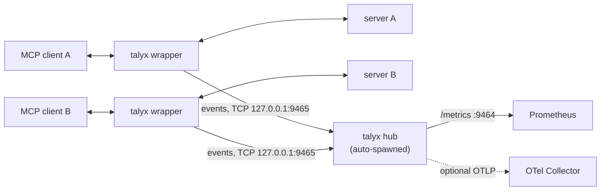

# Architecture

English | [繁體中文](architecture.zh-TW.md)

## What this is

A Prometheus exporter and alerting proxy for MCP servers. You wrap it around
any stdio MCP server — the client spawns the proxy instead of the server, and
the proxy spawns the real server — and it exports metrics about the traffic
flowing through it. No code changes to the server, no database, no account.

## Positioning

The MCP-proxy space splits by **what signal you get** and **where it lives**.
This project occupies the metrics-and-alerting corner:

- **Metrics + alerting (this project).** Zero-code stdio proxy. Exports
  Prometheus metrics; Prometheus scrapes `/metrics`; ships a Grafana dashboard
  and Alertmanager rules. Stateless — there is no datastore. Answers *"is the
  server healthy, and page me the moment it isn't."*

- **Trace-based proxies.** Also a zero-code proxy, but each JSON-RPC call
  becomes an OpenTelemetry span persisted to a database
  (SQLite / Postgres / MySQL), viewable in Jaeger/Tempo via OTLP. Answers *"walk
  me through why this specific call behaved the way it did."* Rich per-call
  detail; the trade-off is a datastore to run and no built-in alerting.

Traces and metrics are **complementary** — the same way Jaeger and Prometheus
are complementary in a normal observability stack. This project
deliberately owns only the metrics-and-alerting leg and leans on that focus.

Two rules follow from this and shape every decision:

1. **Always stateless.** No database, ever. Prometheus scrapes `/metrics`;
   that's the whole storage story. This is the core structural difference from
   trace-to-database designs.
2. **Observe, never block.** No policy, allow/deny, or resource locking — this
   project only observes and reports; it never sits in the request path as a
   gatekeeper. (Trace/gateway proxies do offer policy and locking; that's a
   different job.)

*"Trace-based proxies often grow toward policy enforcement and gatekeeping over
time; this project deliberately stays on the observation side of that line."*

## Why a proxy, not an SDK

An SDK means editing the server: adding a dependency, instrumenting handlers,
redeploying. That doesn't work when the server is someone else's binary, an
`npx` package, or written in a language you don't build. A stdio proxy needs
zero changes to the server — the user only edits their MCP client config to
point at the proxy instead. The trade-off is that a proxy sees the wire
protocol, not the server's internals; every metric here is defined purely in
terms of what's observable on the JSON-RPC stream, which is exactly the health
signal an operator wants.

## Data flow

The pump forwards bytes untouched in both directions; observation is a
side-channel. If parsing ever fails, forwarding is unaffected — correctness of
the proxy never depends on what the tracker understands.

### Hub

Each wrapper (`talyx -- <cmd>`) ships its events to one long-lived hub instead
of exposing its own port:

- The hub is auto-spawned by the first wrapper (or by `talyx dashboard up`) and
  owns the single `/metrics` on 9464 and `TALYX_OTLP_ENDPOINT`. Port 9465 is
  `TALYX_HUB_PORT`; the hub log is `~/.talyx/hub.log`.
- Wrappers queue events and send them once the hub is up. Nothing falls back to
  a local port unless `TALYX_HUB=off`, which restores per-process `/metrics`.
- **What crosses the wire:** event fields only (method name, tool name,
  durations, `wait_type`, error codes). Never parameters, results, or
  `requestState`; the correlation hash stays inside the wrapper's memory.

### `server_up` semantics

`talyx_server_up{server}` separates a clean exit from a crash, otherwise every
closed Claude Code session would look like a dead server:

- Client closes first, server then exits normally: **clean**. The series is
  removed; no alert.
- Client still connected, server exits by itself: **crash**. The gauge goes to
  `0` and the "server down" alert can fire.
- Edge case: if the client closes and the server later crashes on its own, it is
  still reported as clean.

## Design invariants

- **stdout carries only the server's JSON-RPC.** All of the proxy's own logging
  goes to stderr; anything else on stdout would corrupt the protocol.
- **Non-blocking, deadlock-free I/O.** Each stream direction is pumped
  independently on the asyncio event loop, so a slow reader on one stream can't
  stall the others.
- **Bounded memory.** The request→response pairing table has a TTL, so a
  request that never gets a response cannot leak.
- **Observation is best-effort.** Exceptions in the metrics path are swallowed
  and logged to stderr; they never break forwarding. (One consequence: abandoned
  cycles are swept lazily — a stalled cycle is marked abandoned when traffic
  next arrives after the timeout window, so on a fully idle server that marking
  is deferred until traffic resumes. A background sweeper is on the roadmap.)

## Not in the MVP (roadmap)

HTTP/SSE transport, OAuth, OTLP trace/span export (pushed to your own
Tempo/Jaeger, so the proxy stays stateless), a Helm chart, and optional body
capture (redacted / hash / full). Token usage is not observable in MCP protocol
traffic, so this project does not claim or expose token metrics.