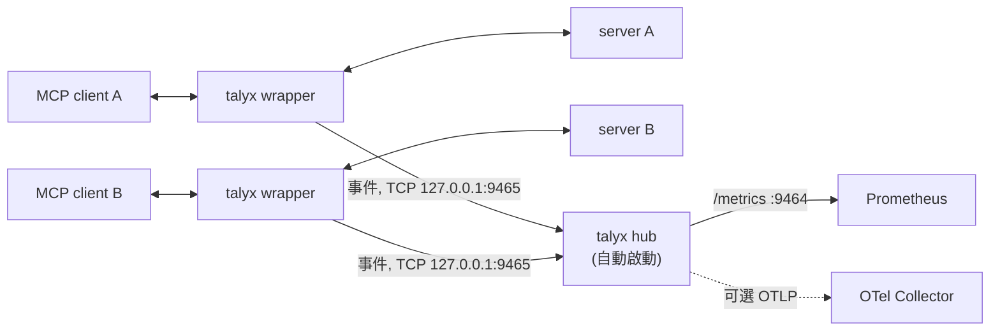

# 產品架構（Architecture）

[English](architecture.md) | 繁體中文

## 簡介

一個給 MCP server 用的 Prometheus 匯出器與告警 proxy。將它包在任何 stdio MCP
server 外面，client 改成啟動這個 proxy，再由 proxy 啟動真正的 server，它就會把流經其中的流量匯出成指標。安插此 proxy 不需改 server，沒有資料庫，沒有帳號，只需一行程式碼。

## 定位

本專案定位「指標＋告警」而非 Trace：

- **指標＋告警（本專案）。** Zero-code stdio proxy。匯出 Prometheus 指標；Prometheus
  抓 `/metrics`；內附一組 Grafana dashboard 與 Alertmanager 規則。監控全程Stateless，沒有資料存放。

- **Trace 型 proxy。** 同樣是 zero-code proxy，但每個 JSON-RPC 呼叫會變成一個
  OpenTelemetry span、存進資料庫（SQLite / Postgres / MySQL），透過 OTLP 在
  Jaeger/Tempo 觀看。

Trace 與 metrics 是**互補**的——就像 Jaeger 與 Prometheus 在一般 observability 堆疊
中互補一樣。本專案刻意只顧「指標＋告警」，並專注於此。

由此衍生兩條規則，主導每一個決策：

1. **永遠 stateless。** 永不用資料庫。Prometheus 抓 `/metrics` 存取
2. **只觀測，不阻擋。** 沒有 policy、allow/deny 或資源鎖——本專案只觀測與回報；它絕不以守門員的身分坐在請求路徑上。（Trace/gateway 型 proxy 可能提供 policy 與 resource lock）

> *「Trace 型 proxy 往往隨時間長成 policy 執行與 gateway；本專案刻意不往該方向發展，而是專注在觀測。」*

## 為什麼用 proxy，而不是 SDK

用 SDK 意味著要改 server：加相依、在 handler 埋點、重新部署。當 server 是第三方 library 或不熟的語言寫成時，就會面臨使用障礙。stdio proxy
對 server 零改動——使用者只要改 MCP client 設定，指向 proxy 就好。代價是 proxy 看到的
是 wire 協定、不是 server 內部；這裡每個指標都純粹以「JSON-RPC 串流上可觀測到什麼」來
定義，而那是維運者要的健康訊號。

## 資料流

pump 在兩個方向都原封轉發位元組；觀測是旁路（side-channel）。就算解析失敗，轉發也不
受影響——proxy 的正確性不取決於 tracker 理解了什麼。

### Hub

每個包裝程序（`talyx -- <cmd>`）不再自己開埠，而是把事件送到一個常駐 hub：

- hub 由第一個包裝程序（或 `talyx dashboard up`）自動啟動，持有唯一的 `/metrics`
  （9464）與 `TALYX_OTLP_ENDPOINT`。9465 是 `TALYX_HUB_PORT`；hub 的 log 在
  `~/.talyx/hub.log`。
- 包裝程序會先把事件排隊，hub 一起來就送出。除非設 `TALYX_HUB=off`（恢復每程序各開
  `/metrics`），否則不會退回本機埠。
- **線上傳的內容：** 只有事件欄位（方法名、tool 名、耗時、`wait_type`、錯誤碼），
  絕不含參數、結果或 `requestState`；關聯用的雜湊只留在包裝程序的記憶體內。

### `server_up` 語意

`talyx_server_up{server}` 區分正常結束與崩潰，否則每關一次 Claude Code session 都會
像是 server 死掉：

- client 先關閉、server 隨後正常結束：**正常結束**。該序列被移除，不告警。
- client 仍連線、server 自己結束：**崩潰**。gauge 設為 `0`，可觸發「server 死亡」告警。
- 邊界情況：若 client 關閉後 server 才自行崩潰，仍會被視為正常結束。

## 設計不變式（invariants）

- **stdout 只承載 server 的 JSON-RPC。** proxy 自己的所有 log 都走 stderr；stdout 上
  出現別的東西都會污染協定。
- **非阻塞、無死鎖的 I/O。** 每個串流方向在 asyncio event loop 上獨立 pump，所以某個
  串流的 slow reader 不會卡住其他串流。
- **有限制記憶體。** 請求→回應的配對表有 TTL，所以永遠等不到回應的請求不會外洩。
- **觀測是盡力而為（best-effort）。** 指標路徑上的例外會被吞掉並記到 stderr；它們絕不
  中斷轉發。（一個後果：abandoned 循環是**惰性掃描**——一個卡住的循環要等逾時窗過後、
  下一筆流量到達時才被標記為 abandoned，所以在完全閒置的 server 上，這個標記會延到流量
  恢復才發生。背景掃描器在 roadmap 上。）

## 待開發（roadmap）

HTTP/SSE transport、OAuth、OTLP trace/span 匯出（推到你自己的 Tempo/Jaeger，讓
proxy 維持 stateless）、Helm chart，以及可選的 body capture（遮蔽／雜湊／完整）。
token 用量在 MCP 協定流量中觀測不到，所以本專案不宣稱、也不暴露 token 指標。
